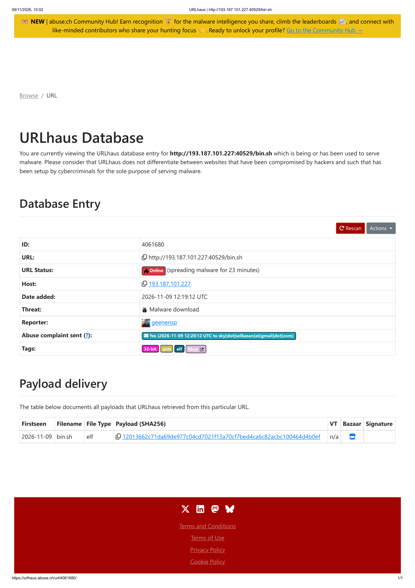
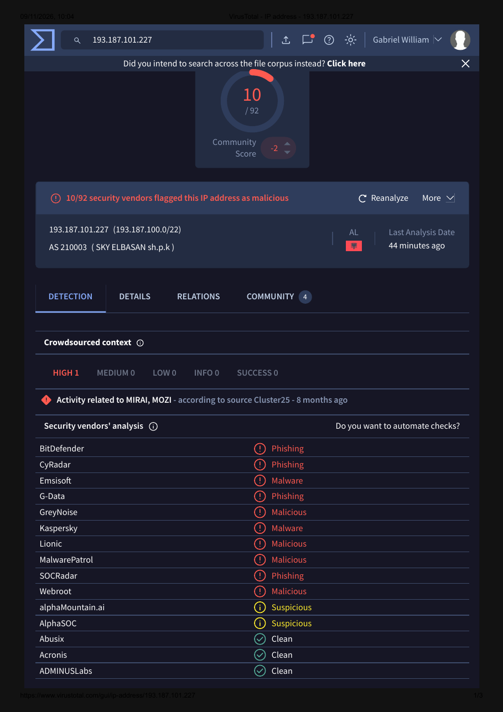
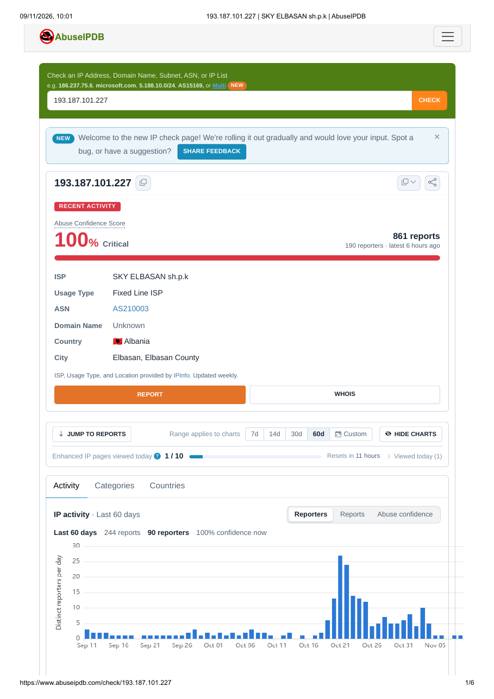
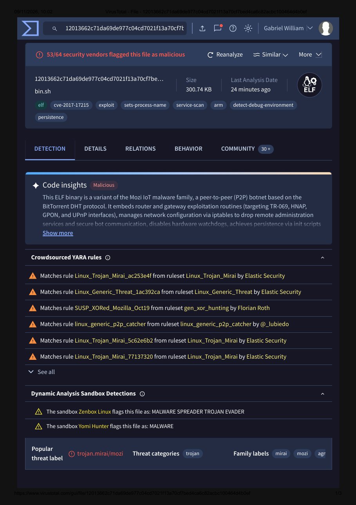

# Análise de IOC: distribuição da botnet Mozi (IoT)

Investigação de um indicador de comprometimento (IOC) com ferramentas gratuitas de Threat Intelligence, simulando a triagem feita por um analista de SOC N1.

**Data da análise:** 09/11/2026
**Autor:** Gabriel William Carvalho da Silva

---

## 1. Objetivo

Investigar uma URL listada no URLhaus como distribuidora de malware, identificar a ameaça, avaliar a reputação da infraestrutura envolvida e definir um veredito com recomendações de resposta.

## 2. Ferramentas utilizadas

| Ferramenta | Uso |
|---|---|
| URLhaus (abuse.ch) | Origem do indicador e contexto inicial |
| VirusTotal | Reputação do IP e análise do arquivo pelo hash |
| AbuseIPDB | Histórico de denúncias e comportamento do IP |

## 3. Cuidados de segurança

- A URL maliciosa **não foi acessada** em nenhum momento; apenas consultada nas plataformas de análise.
- O arquivo **não foi baixado**: a análise foi feita pelo hash SHA256 já existente no VirusTotal.
- Todos os indicadores abaixo estão "desarmados" (`hxxp`, `[.]`) para evitar cliques acidentais.

## 4. Indicador investigado

| Tipo | Valor |
|---|---|
| URL | `hxxp://193.187.101[.]227:40529/bin.sh` |
| Ameaça (URLhaus) | Download de malware |
| Tags | 32-bit, arm, elf, Mozi |
| Adicionada ao URLhaus | 2026-11-09 12:19:12 UTC |

**Hipótese inicial:** um dispositivo IoT infectado servindo o malware da botnet Mozi para infectar outros dispositivos. Indícios: porta alta e incomum (40529), script `bin.sh` como "baixador" e executável ELF para processador ARM, comum em roteadores e câmeras.

## 5. Análise

### 5.1 Reputação do IP no VirusTotal

- **Detecção:** 10 de 92 fornecedores marcaram o IP como malicioso.
- **Contexto da comunidade:** atividade relacionada a **Mirai e Mozi** (fonte: Cluster25).
- **Rede:** AS210003, SKY ELBASAN sh.p.k, Albânia.

> A detecção relativamente baixa (10/92) é esperada: o IP pertence a um provedor residencial, então muitos fornecedores não o classificam como malicioso. Por isso a análise não deve se basear em uma única fonte.

### 5.2 Histórico do IP no AbuseIPDB

- **Abuse Confidence Score:** 100% (crítico)
- **Denúncias:** 861 relatos de 190 fontes diferentes (primeira em 29/01/2026, mais recente há poucas horas)
- **Tipo de uso:** provedor de internet de linha fixa (residencial), Elbasan, Albânia
- **Categorias mais frequentes:** varredura de portas (133), força bruta (115), SSH (54), hacking (37), IoT direcionada (34)
- **Padrão observado nos relatos:** tentativas na **porta 23 (Telnet)** e em SSH, com credenciais padrão `admin/admin`, registradas por honeypots

### 5.3 Análise do arquivo pelo hash (VirusTotal)

- **SHA256:** `12013662c71da69de977c04cd7021f13a70cf7bed4ca6c82acbc100464d4b0ef`
- **Nome:** bin.sh | **Tipo:** ELF (Linux) | **Tamanho:** 300,74 KB
- **Detecção:** 53 de 64 fornecedores marcaram como malicioso
- **Classificação popular:** `trojan.mirai/mozi`
- **Tags relevantes:** `cve-2017-17215`, `exploit`, `persistence`, `detect-debug-environment`
- **Regras YARA:** correspondência com várias regras `Linux_Trojan_Mirai` (Elastic Security) e de comunicação P2P
- **Sandbox:** Zenbox Linux classificou como *MALWARE SPREADER TROJAN EVADER*

Resumo do comportamento descrito pela análise: variante da botnet **Mozi**, que se comunica de forma ponto a ponto (P2P) e explora roteadores e gateways, usa `iptables` para bloquear o acesso administrativo ao dispositivo infectado e busca se manter persistente.

> A **CVE-2017-17215** é uma vulnerabilidade de execução remota de código em roteadores Huawei HG532, explorada historicamente por botnets da família Mirai. A Mozi reaproveita parte do código da Mirai, o que explica as detecções com os dois nomes.

## 6. Mapeamento MITRE ATT&CK (resumo)

| Técnica | ID | Evidência |
|---|---|---|
| Brute Force | T1110 | Tentativas Telnet/SSH com `admin/admin` |
| Exploit Public-Facing Application | T1190 | Exploração da CVE-2017-17215 em roteadores |
| Ingress Tool Transfer | T1105 | Download do payload via `bin.sh` |
| Network Service Discovery | T1046 | Varredura de portas relatada no AbuseIPDB |

## 7. Indicadores de Comprometimento (IOCs)

| Tipo | Valor |
|---|---|
| IP | `193.187.101[.]227` |
| URL | `hxxp://193.187.101[.]227:40529/bin.sh` |
| SHA256 | `12013662c71da69de977c04cd7021f13a70cf7bed4ca6c82acbc100464d4b0ef` |
| ASN | AS210003 (SKY ELBASAN sh.p.k) |

## 8. Conclusão

**Veredito: MALICIOSO (confirmado).**

As três fontes são consistentes: o URLhaus aponta distribuição ativa de malware, o AbuseIPDB mostra um histórico extenso e recente de varreduras e força bruta, e o arquivo é detectado por 53 de 64 fornecedores como Mirai/Mozi. O IP provavelmente pertence a um **roteador ou dispositivo IoT residencial já infectado**, que agora atua como parte da botnet atacando e infectando outros dispositivos.

## 9. Recomendações

1. Bloquear o IP e a URL no firewall e no proxy da organização.
2. Adicionar o hash SHA256 à lista de bloqueio do EDR/antivírus.
3. Pesquisar no SIEM por conexões de/para o IP e pelo hash nos últimos 30 dias.
4. Garantir que dispositivos IoT e roteadores não exponham **Telnet (23) ou SSH** à internet e que nenhuma credencial padrão (`admin/admin`) esteja em uso.
5. Manter firmwares de roteadores atualizados, em especial contra a CVE-2017-17215.

## 10. Aprendizados

- Uma única fonte pode enganar: o IP teve detecção baixa no VirusTotal, mas 100% de confiança no AbuseIPDB.
- Analisar pelo **hash** permite investigar um malware sem precisar baixá-lo.
- Credenciais padrão em dispositivos IoT continuam sendo uma das principais portas de entrada de botnets.
